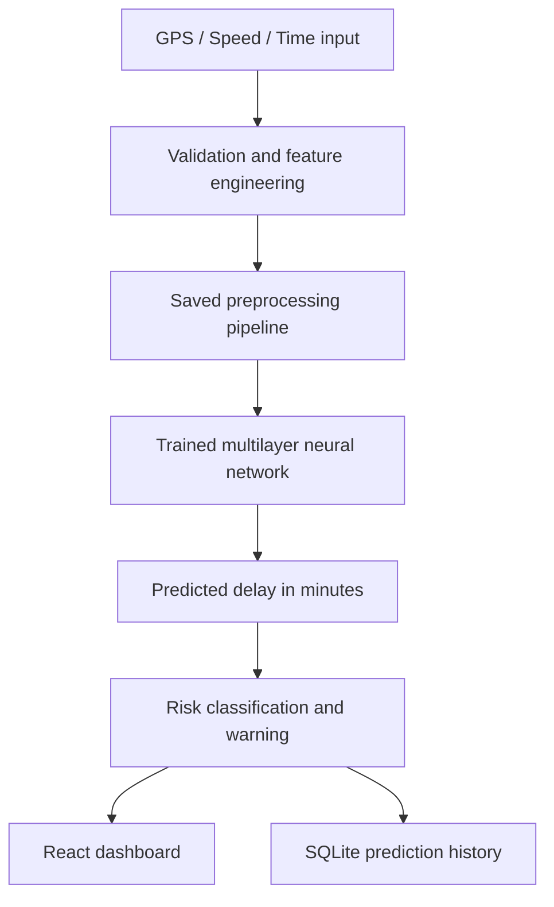

# IoT-Based Public Transport Delay Prediction using DNN

A runnable academic demonstration of a public transport delay prediction pipeline: vehicle GPS/speed/time inputs → preprocessing → trained multilayer neural network → predicted delay → risk warning → SQLite history.

## Important data limitation

The included `backend/data/synthetic_transport_delays.csv` is **synthetic demonstration data**, generated for this project. It is not actual transit authority data and does not prove real-world accuracy. Replace it with a suitable, documented historical dataset before making real-world performance claims.

## Stack

- React + Vite dashboard
- FastAPI prediction API
- scikit-learn `MLPRegressor` with hidden layers (64, 32, 16), a DNN-style multilayer perceptron
- Pandas, NumPy, scikit-learn preprocessing
- SQLite prediction history
- Pytest API checks

## Requirements

- Python 3.11 recommended
- Node.js LTS and npm

## Run on Windows

### 1. Train the model

Open PowerShell in the repository root:

```powershell
cd backend
py -3.11 -m venv .venv
.\.venv\Scripts\Activate.ps1
python -m pip install --upgrade pip
pip install -r requirements.txt
python train_model.py
```

Training saves `backend/artifacts/delay_model.joblib` and `backend/artifacts/metrics.json`. The metrics are from a held-out test split of synthetic data only.

### 2. Start the API

In the same backend terminal:

```powershell
uvicorn app.main:app --reload
```

API docs: http://127.0.0.1:8000/docs  
Health: http://127.0.0.1:8000/api/health

### 3. Start the frontend

Open a second PowerShell terminal from the repository root:

```powershell
cd frontend
npm install
npm run dev
```

Open the local URL printed by Vite, typically http://localhost:5173.

### 4. Try a prediction

Use the dashboard form or send this request to `POST http://127.0.0.1:8000/api/predict`:

```json
{
  "route_id": "R01",
  "latitude": 11.0168,
  "longitude": 76.9558,
  "speed_kmph": 18,
  "timestamp": "2026-10-29T08:30:00+05:30",
  "data_mode": "simulated"
}
```

The response contains `predicted_delay_minutes`, `risk_level`, `warning`, and `data_mode`. Predictions are produced by the saved model, not a hardcoded output.

### 5. Tests

From `backend` with the virtual environment active:

```powershell
pytest -q
```

Frontend build:

```powershell
cd ..\frontend
npm run build
```

## API endpoints

- `GET /api/health`
- `GET /api/model/metrics`
- `POST /api/predict`
- `GET /api/predictions`
- `GET /api/analytics/summary`

## Input features

`route_id`, `latitude`, `longitude`, `speed_kmph`, hour of day, and day of week. The target is `delay_minutes`. Actual delay and actual arrival are not used as prediction inputs.

## Warning thresholds

- Low: predicted delay < 5 minutes
- Medium: 5 to < 15 minutes
- High: ≥ 15 minutes

## Architecture



## Known limitations and future work

- Synthetic data is for software demonstration only.
- The included simulator is not connected to real buses or a live GPS feed.
- A real deployment needs historical ground-truth data, time-aware validation, drift monitoring, privacy safeguards, and evaluation against a suitable baseline.
- Future work: integrate GPS/ESP32 data, map-matched routes, traffic/weather feeds, and time-series evaluation.
